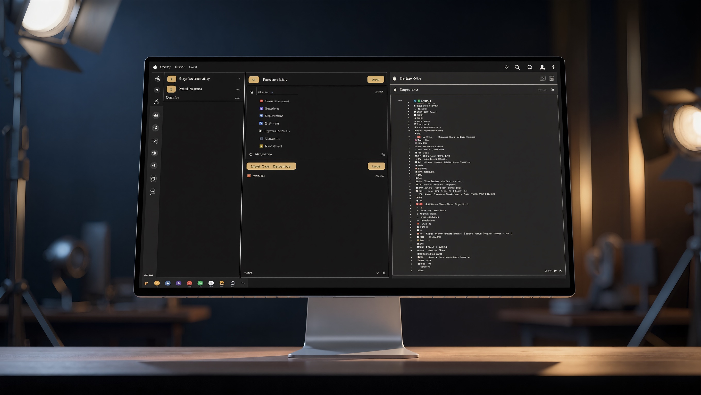

<p align="center">
  
</p>

<h1 align="center">Punani AI</h1>

<p align="center">
  <strong>The coding agent that asks before it touches your repo.</strong><br />
  Free-first for builders on zero-cost models · or bring OpenAI, Groq, OpenRouter, Ollama — your keys
</p>

<p align="center">
  <a href="https://punani.agency">Website</a> ·
  <a href="https://github.com/Nagacash/Punani-AI">GitHub</a> ·
  <a href="https://nagacodex.cloud">Naga Codex</a>
</p>

<p align="center">
  
  
  
  
</p>

<p align="center">
  
</p>

---

## Why it feels like a paid product

| | |
| --- | --- |
| **Who it’s for** | **Free-model crew** — live on free tiers, Ollama, or can’t pay for $20/mo agents. **Key holders** — OpenAI, Groq, OpenRouter, whatever you already use. Same agent either way. |
| **Free experience** | Not a toy: tools, MCP, diffs, browser UI. Free models ranked first; failover when a provider rate-limits. No Punani subscription. |
| **Permissions** | Ordered rules per action — allow, ask, deny. Last match wins. Same engine in terminal and browser. |
| **Diffs** | Every write is previewed before it lands. |
| **Surfaces** | Full terminal agent, `punani web` UI with live preview, MCP tools from any server you add. |
| **Models** | OpenRouter, NVIDIA NIM, Groq, Cerebras, OpenAI, FreeLLMAPI, Ollama, LM Studio — live catalogs, pricing shown up front. |
| **Cost** | MIT licensed. Your keys on your machine. We don’t resell tokens. |

<p align="center">
  
</p>

---

## This repository

**Punani-AI** is the marketing site and waitlist (**[punani.agency](https://punani.agency)**).

The agent CLI is **`punani-powerd`** on npm (package name `punani-powerd`, command `punani`).

This repo is **only the landing page** (Next.js + Clerk). The “one dependency” pitch
applies to **`punani-powerd`**, not this site.

**Most people never clone this repo.** Install the agent once globally, use your own API keys, and run `punani` or `punani web`. Clone **Punani-AI** only if you contribute to the site; clone **punani-powerd** only if you hack on the agent itself.

### Run locally

```bash
npm install
cp .env.example .env.local   # Clerk dev keys — see below
npm run dev                    # http://localhost:3000
```

### Clerk (Punani AI app)

- Instance: [known-muskrat-4119](https://known-muskrat-4119.clerk.accounts.dev) (dev) · production: **punani.agency**
- App ID: `app_3KxiqECH7u1jNM0SF1h9mcckE8K`
- **Not** the Naga-Automation Clerk app.

```bash
npx -y clerk@latest auth login
npx -y clerk@latest link --app app_3KxiqECH7u1jNM0SF1h9mcckE8K
npx -y clerk@latest env pull --file .env.local
```

Production: **`pk_live_` / `sk_live_`** on Vercel only. Keep **`pk_test_`** in `.env.local` for localhost.

**Waitlist:** In the Clerk dashboard (dev **and** production instances), turn on **Waitlist** and leave **Google / SSO off**. **Join the list** is email-only via Clerk’s waitlist modal.

---

## Install the agent (end users)

One-time global install — it stays on your PATH until you upgrade or uninstall:

```bash
npm i -g punani-powerd
punani --init
punani          # terminal
punani web      # browser on :4096 — token from terminal, not Clerk
```

Upgrade later: `npm i -g punani-powerd@latest`

---

## License

[MIT](./LICENSE) · Copyright (c) 2026 Naga Codex

---

<p align="center">
  <a href="https://nagacodex.cloud"><strong>nagacodex.cloud</strong></a> — Naga Codex · Maurice Holda · Hamburg
</p>
